<div align="center">

# 🌧️ Rainfall Prediction and Pattern Analysis Using Historical Indian Meteorological Data
### INT234 — Predictive Analytics Project

[](https://www.python.org/)
[](https://scikit-learn.org/)
[](https://pandas.pydata.org/)
[](https://numpy.org/)
[](LICENSE)
[](https://github.com/RamCharanTejaKesarapu)

<p align="center">
  <b>A comprehensive data science and machine learning study analyzing 117 years (1901–2017) of rainfall records across 36 Indian subdivisions. Features robust time-series feature engineering, 6 regression algorithms, and K-Means/PCA climatic zonification.</b>
</p>

</div>

---

## 📌 Executive Summary

Precipitation in the Indian subcontinent is driven by complex monsoon dynamics and exhibits dramatic spatiotemporal heterogeneity. Over **70% of India's annual precipitation** occurs during the Southwest Monsoon period (June–September / JJAS), dictating agricultural viability, water reservoir management, and macroeconomic stability.

This project delivers an end-to-end predictive analytics system built on official **India Meteorological Department (IMD)** records spanning **1901 to 2017**:
1. **Data Engineering & Imputation**: Formats 4,188 subdivision-year records into chronologically ordered monthly time series with domain-sensitive historical seasonal imputation.
2. **Feature Engineering**: Constructs cyclical trigonometric transformations ($\sin, \cos$), multi-scale temporal lags ($t-1, t-2, t-12$), rolling statistical windows ($3\text{m}, 12\text{m}$), and past climatological normals.
3. **Supervised Regression Modeling**: Evaluates 6 distinct regressors against rigorous domain baselines using a chronological test partition (last 20% of years) to eliminate data leakage.
4. **Unsupervised Climatic Clustering**: Uses **K-Means clustering** and **Principal Component Analysis (PCA)** to automatically segment India's 36 subdivisions into 5 distinct precipitation regimes based on monthly rainfall profiles.

---

## 🏗️ Architecture & Workflow

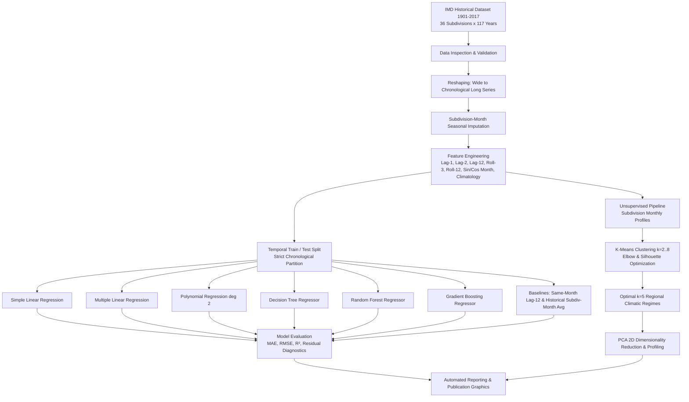

---

## 📊 Exploratory Data Analysis & Visualizations

### 1. 117-Year Annual Rainfall Trend
Observed historical annual rainfall across India from 1901 through 2017 with long-term moving averages and decadal fluctuations:
<p align="center">
  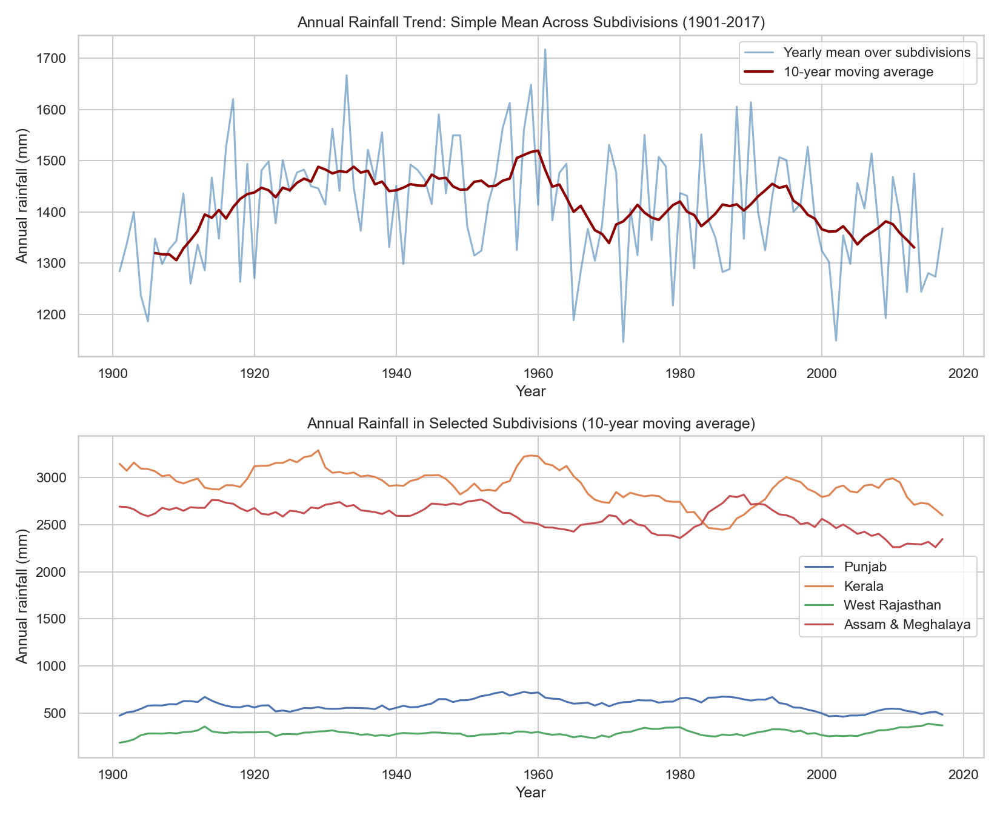
</p>

### 2. All-India Monthly Distribution & Monsoon Signature
Illustrates the monsoonal peak concentrated between June and September (JJAS):
<p align="center">
  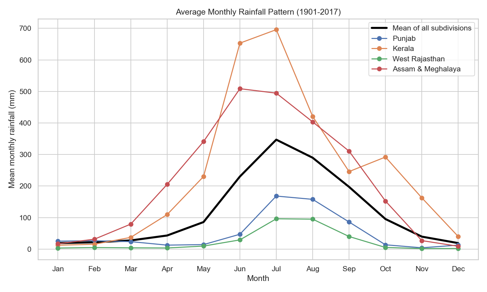
</p>

### 3. Spatial & Temporal Seasonality Heatmap
Comparison of monthly precipitation intensity across all 36 subdivisions:
<p align="center">
  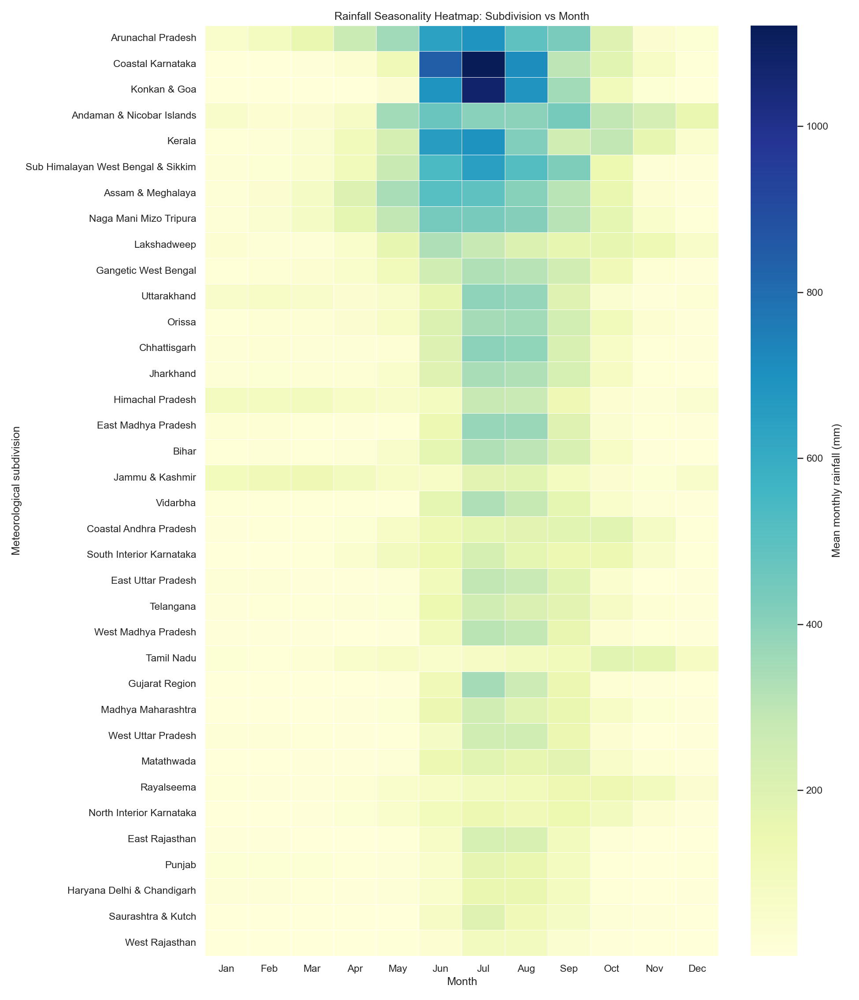
</p>

### 4. Correlation Matrix
Interrelationships between monthly rainfall, seasonal totals, and annual metrics:
<p align="center">
  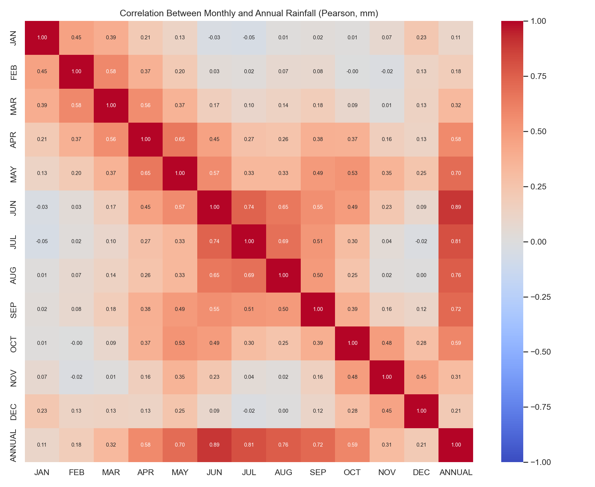
</p>

---

## 🤖 Supervised Learning: Model Performance & Comparison

All models were evaluated on an out-of-sample chronological test holdout (last 20% of observed years) to simulate true predictive forecasting:

| Model | Model Type | Train MAE (mm) | Train RMSE (mm) | Train $R^2$ | Test MAE (mm) | Test RMSE (mm) | **Test $R^2$** | Generalization Gap ($\Delta R^2$) |
| :--- | :---: | :---: | :---: | :---: | :---: | :---: | :---: | :---: |
| 🥇 **Gradient Boosting Regressor** | **Ensemble** | 41.55 | 71.60 | 0.8388 | **39.83** | **67.54** | **0.8348** | **+0.0040** |
| 🥈 **Multiple Linear Regression** | **Linear** | 42.82 | 75.03 | 0.8230 | **39.55** | **67.79** | **0.8336** | **-0.0106** |
| 🥉 **Random Forest Regressor** | **Ensemble** | 35.77 | 60.44 | 0.8852 | 40.67 | 68.56 | **0.8298** | +0.0553 |
| 4. Polynomial Regression (degree 2) | Polynomial | 42.43 | 74.40 | 0.8260 | 39.66 | 68.75 | **0.8289** | -0.0029 |
| 5. Simple Linear Regression | Linear | 42.98 | 75.92 | 0.8188 | 41.20 | 69.44 | **0.8254** | -0.0067 |
| 6. Decision Tree Regressor | Tree | 40.66 | 70.22 | 0.8450 | 40.77 | 70.08 | **0.8222** | +0.0228 |
| *Baseline: Historical Subdiv-Month Avg* | *Baseline* | 41.23 | 73.63 | 0.8295 | 41.23 | 70.59 | 0.8196 | +0.0100 |
| *Baseline: Same Month Last Year (Lag-12)* | *Baseline* | 55.73 | 100.03 | 0.6854 | 53.26 | 94.09 | 0.6795 | +0.0059 |

### Visual Model Evaluation

<p align="center">
  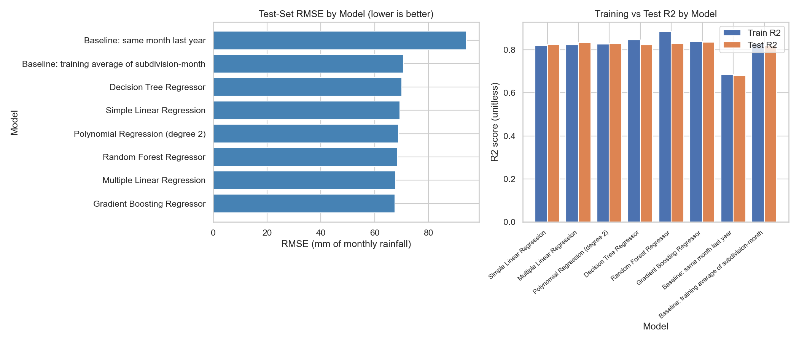
</p>

### Actual vs. Predicted Predictions & Residual Diagnostics
<p align="center">
  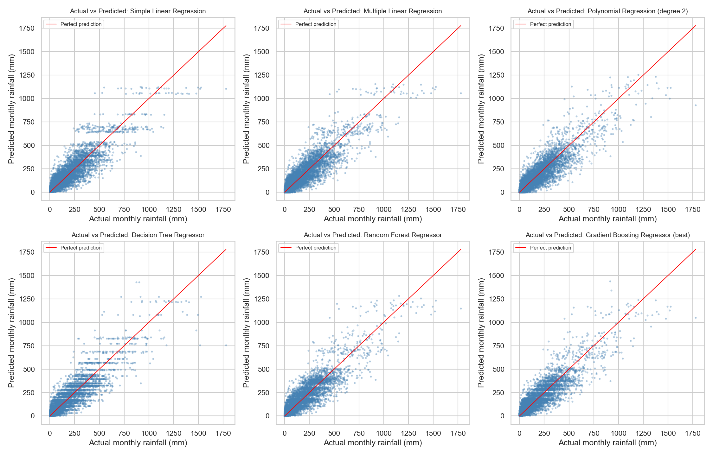
</p>

<p align="center">
  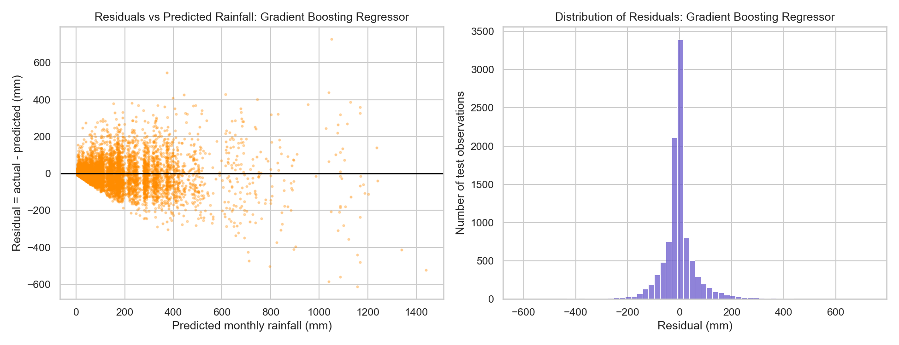
</p>

### Feature Importance (Gradient Boosting)
Key predictive drivers identified by the best-performing model:
<p align="center">
  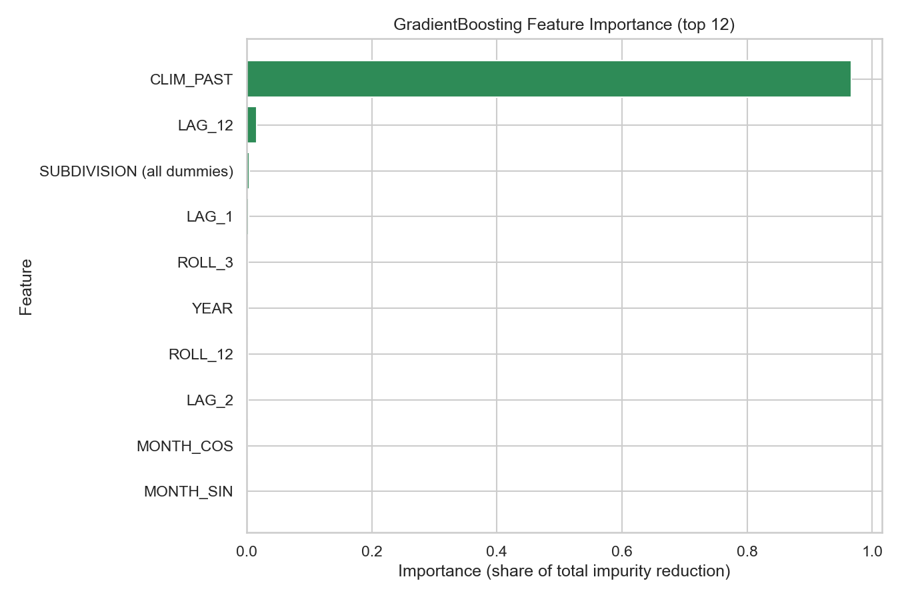
</p>

---

## 🗺️ Unsupervised Learning: Climatic Zonification (K-Means & PCA)

Using the 12-month normalized rainfall distribution for each subdivision, K-Means clustering was executed across $k \in [2, 8]$. The **optimal configuration ($k=5$)** was determined via Elbow analysis and Silhouette scores:

<p align="center">
  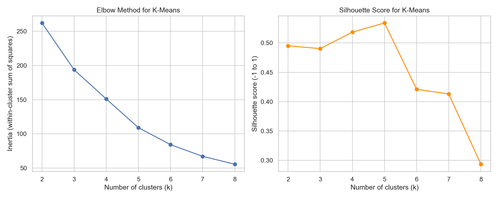
</p>

### Discovered Meteorological Regimes

| Cluster | Subdivisions (Count) | Mean Annual (mm) | JJAS Share | Peak Month | Key Characteristics & Subdivisions |
| :---: | :--- | :---: | :---: | :---: | :--- |
| **0** | **Western Ghats High Intensity** (2) | 3,191.4 mm | **90.7%** | July | Extreme orographic rainfall during SW monsoon (*Coastal Karnataka, Konkan & Goa*). |
| **1** | **Western Himalayas** (3) | 1,286.2 mm | 61.4% | July | Dual precipitation peaks: winter/spring western disturbances + summer monsoon (*Himachal Pradesh, J&K, Uttarakhand*). |
| **2** | **Island & Southern Peninsular** (4) | 2,095.0 mm | 56.0% | June | Bimodal monsoon regime receiving heavy precipitation during both SW and NE monsoons (*Kerala, Tamil Nadu, Lakshadweep, Andaman & Nicobar*). |
| **3** | **Northeastern Heavy Monsoonal** (4) | 2,796.6 mm | 69.0% | July | Extended rainy season with significant pre-monsoon showers (*Assam & Meghalaya, Arunachal Pradesh, Nagaland-Manipur-Mizoram-Tripura, Sub-Himalayan West Bengal*). |
| **4** | **Continental Monsoonal Plains & Plateau** (23) | 936.4 mm | **82.0%** | July | Classic Indian summer monsoon regime spanning the Gangetic plain, central India, and Deccan plateau (*23 subdivisions including Punjab, UP, Bihar, Maharashtra, Rajasthan*). |

### 2D Principal Component Projection (PCA)
<p align="center">
  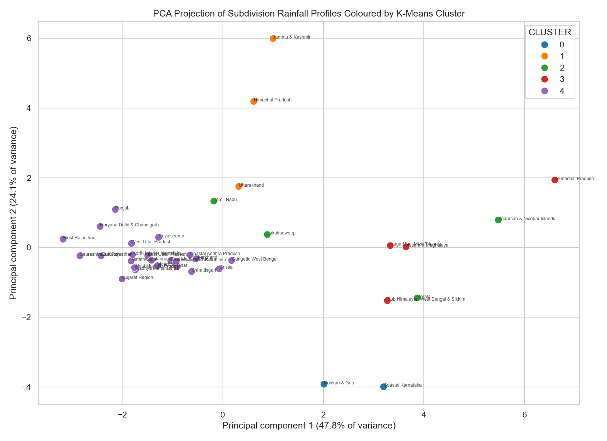
</p>

### Cluster Monthly Profiles
<p align="center">
  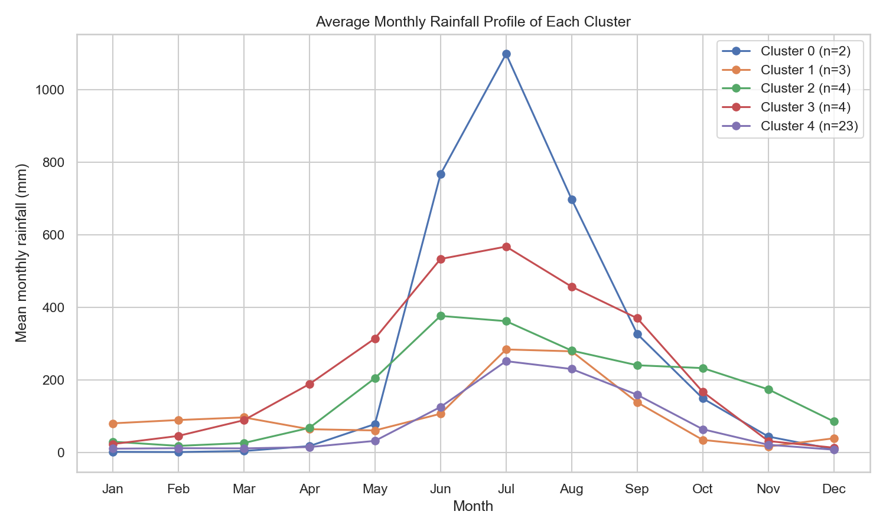
</p>

---

## 📁 Repository Structure

```text
├── data/
│   ├── Sub_Division_IMD_2017.csv         # Raw 117-year IMD dataset (1901-2017)
│   └── README.md                         # Detailed data schema and source notes
├── rainfall_results/                     # Output artifacts generated by the pipeline
│   ├── cleaned_rainfall.csv              # Reshaped long-format dataset with engineered features
│   ├── cluster_assignments.csv           # Final K-Means cluster labels per subdivision
│   ├── cluster_summary.csv               # Aggregated climate statistics per cluster
│   ├── model_comparison.csv              # Benchmark metrics table across all models
│   ├── regression_predictions.csv        # Out-of-sample predictions vs ground truth
│   ├── project_summary.txt               # Full execution log and audit report
│   └── *.png                             # High-resolution diagnostic figures & plots
├── .github/
│   └── workflows/
│       └── ci.yml                        # GitHub Actions automated test & build pipeline
├── rainfall_prediction.py                # Main executable pipeline (supports CLI flags)
├── rainfall_prediction_8_popups.py       # Interactive popup execution script
├── requirements.txt                      # Project dependencies
├── .gitignore                            # Environment and artifact exclusions
├── CONTRIBUTING.md                       # Contribution guidelines
├── LICENSE                               # MIT License
└── README.md                             # Comprehensive project documentation
```

---

## 🚀 Getting Started

### 1. Prerequisites
Ensure you have **Python 3.9+** installed:
```bash
python3 --version
```

### 2. Clone the Repository
```bash
git clone https://github.com/RamCharanTejaKesarapu/rainfall-prediction-analysis.git
cd rainfall-prediction-analysis
```

### 3. Set Up Virtual Environment (Recommended)
```bash
python3 -m venv .venv
source .venv/bin/activate    # On Windows: .venv\Scripts\activate
```

### 4. Install Dependencies
```bash
pip install -r requirements.txt
```

### 5. Run the Pipeline

#### Standard Execution (Interactive Popups):
```bash
python3 rainfall_prediction.py
```

#### Headless Execution (Automated / Non-Interactive):
To run silently without plot windows popping up (ideal for scripts and CI):
```bash
python3 rainfall_prediction.py --no-popup
```
*All 20+ figures, CSV tables, and summary reports will be exported automatically to the `rainfall_results/` directory.*

---

## 📦 Tech Stack

- **Language**: Python 3.9+
- **Data Manipulation**: [Pandas](https://pandas.pydata.org/), [NumPy](https://numpy.org/)
- **Machine Learning**: [scikit-learn](https://scikit-learn.org/) (LinearRegression, DecisionTree, RandomForest, GradientBoosting, KMeans, PCA, Pipeline, ColumnTransformer)
- **Data Visualization**: [Matplotlib](https://matplotlib.org/), [Seaborn](https://seaborn.pydata.org/)
- **CI / Automation**: GitHub Actions

---

## 📜 Academic Attribution

- **Course**: INT234 — Predictive Analytics
- **Author**: Ram Charan Teja Kesarapu ([@RamCharanTejaKesarapu](https://github.com/RamCharanTejaKesarapu))
- **Data Source**: India Meteorological Department (IMD), Ministry of Earth Sciences, Government of India.

---

## 📄 License

This project is licensed under the MIT License — see the [LICENSE](LICENSE) file for details.
